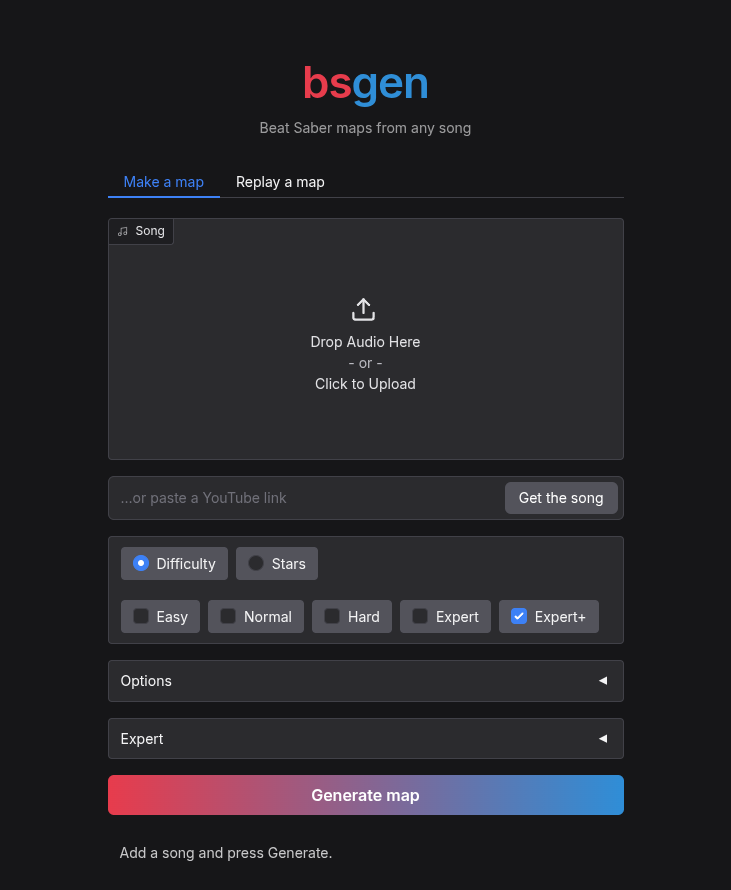

<p align="center"></p>

<p align="center">Beat Saber maps from any song, and a model that plays them.</p>

<p align="center"><a href="https://colab.research.google.com/github/cata02222/bsgen/blob/main/colab.ipynb"></a> <a href="https://discord.gg/DCFdQYAQV4"></a></p>

<p align="center">
 
 
</p>

## Run it

Easiest: the Colab button above. Run both cells, open the link.

On your own machine (Python 3.10+ and ffmpeg):

```
git clone https://github.com/cata02222/bsgen
cd bsgen
pip install -e .
python scripts/webui.py
```

## Web UI



## Replays

Tick "Also make replays" and the player model plays each difficulty. The `.bsor` replay lands next
to the map; open both in a web replay viewer to watch it. Without the web page:

```
python scripts/generate.py --audio song.mp3 --stars 10 --replay
python scripts/play.py --map "out/song 10star.zip" --diff ExpertPlus
```

## Models

The [bsgen-1.0](https://huggingface.co/cata121/bsgen-1.0) models:
- rhythm model: 47M parameters, picks when the notes come
- map model: 65M parameters, ~70 min on one H100, fills them in
- lighting model: 7M parameters, the lightshow
- player model: 38M parameters, ~1 hour on one H100

The 1.0 and 1.1 map models are still in the menu under Expert.

## Changelog

**1.2**
- new map model, trained from scratch on more songs
- a rhythm model picks the hits first
- stars closer to what you asked for
- lighting model, and a scene picker
- covers and artist names found online
- less repeating, no notes that make the sabers meet head on
- faster on Linux
- paste a YouTube link instead of adding a file
- acc style stays calmer at 8★ and up

**1.1**
- new map model, better at low and mid stars
- better BPM timing, songs that change tempo too
- replays: a player model plays your map
- small fixes: note speed per star level, no bomb floods, a progress bar

**1.0**
- first release

## Star it

If bsgen made you a map you liked, a star on this repo helps a lot ⭐

## License

AGPL-3.0
